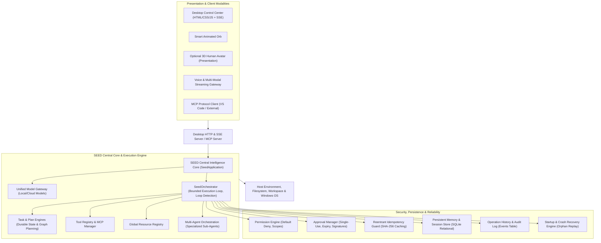

# SEED-AI — Final Master Architecture & Product Blueprint

**Document ID:** `SEED_FINAL_MASTER_ARCHITECTURE_AND_BLUEPRINT`
**Status:** Approved & Active
**Date:** 18 November 2026

---

## 1. Final Product Architecture & Core Topology

SEED-AI is structured as a centralized personal intelligence system. The architecture guarantees that all interaction modalities (Text, Voice, Desktop UI, MCP clients) and multi-agent workloads converge strictly through the **SEED Central Intelligence Core (`SeedApplication` & `SeedOrchestrator`)**. No secondary agent or interface possesses autonomous authority to bypass permissions, model routing, or memory governance.

---

## 2. Final Desktop Product Design & UX Experience

The final user experience replaces isolated chat windows with an immersive **SEED Desktop Control Center**:

1. **Main Intelligence Interface:**
   - Unified conversational stream supporting rich text, documents, code snippets, and action cards.
   - Low-latency input supporting text and streaming voice with barge-in capabilities.
   - Context-aware session continuity across restarts.

2. **Animated Intelligence Orb:**
   - Central visual anchor representing SEED's cognitive state (`idle`, `listening`, `processing`, `speaking`, `executing`, `awaiting_approval`, `warning`, `error`, `recovering`).
   - Driven deterministically by SEED Core state changes via Server-Sent Events (SSE).

3. **Optional 3D Human Avatar:**
   - Plug-and-play visual avatar layer synchronized with SEED state, visemes, and audio stream. Operates strictly as a presentation proxy without policy authority.

4. **Dedicated Control Center Panels:**
   - **Active Tasks & Plan Graph:** Visualize ongoing goal decomposition, dependencies, and execution progress.
   - **Agents & Tools:** Monitor registered specialized agents, tool schemas, and MCP servers.
   - **Global Resource Registry:** Inspect registered local directories, Git repos, development environments, and connected hardware/networks.
   - **Approvals & Governance:** Review pending high-risk or destructive operation requests with exact argument diffs and identity metadata.
   - **System Health & Audit Logs:** Real-time metrics (CPU, memory, disk, process uptime) and immutable event trails.

---

## 3. Current State vs. Final Target (Gap Analysis)

| Component | Current State | Completeness | Missing for Final Target | Verification & Tests |
|---|---|---|---|---|
| **SEED Central Core (`SeedApplication`)** | Implemented & Verified | **90%** | Advanced multi-agent delegation channels | `test_system_integration.py`, `test_orchestrator.py` |
| **Unified Model Gateway** | Implemented (Ollama / OmniRoute abstraction) | **80%** | Live local model inference alignment (`ollama_models`) & streaming tokens | `test_model_gateway.py`, `test_real_inference.py` |
| **Task & Plan Engines** | Relational SQLite persistence & graph state | **85%** | Dynamic plan revision and adaptive re-planning | `test_memory_store.py`, `test_phase3_planning.py` |
| **Tool Registry & MCP** | Registered handlers & MCP stdio server | **85%** | Expanded tool coverage (Git, Unreal, Network infra) | `test_mcp_adapter.py`, `test_foundation.py` |
| **Global Resource Registry** | In-memory/Relational data structures | **40%** | Automated resource discovery and persistent schema registration | New milestone in roadmap |
| **Permissions & Approvals** | Granular scopes, default-deny, expiring tokens | **95%** | Distributed cryptographic signature verification | `test_governance.py` |
| **Persistent Memory & Audit** | SQLite tables for sessions, messages, memory, events | **90%** | Semantic vector search (Qdrant) & automated retention/compaction | `test_memory_store.py`, `test_semantic_memory.py` |
| **Recovery & Reliability** | Loop detection, step/call budgets, orphan recovery | **90%** | Distributed compensation workflows | `test_phase1_acceptance.py` |
| **Desktop Control Center** | Loopback HTTP/SSE server & responsive HTML/JS UI | **75%** | Rich interactive panel widgets for resource management & agent controls | `test_desktop_server.py` |
| **Smart Animated Orb** | SVG/CSS responsive states (`idle`, `processing`, etc.) | **70%** | Advanced audio-reactive frequency spectrum mapping | Visual and SSE tests |
| **3D Human Avatar** | Architectural interface contract (`media.py`) | **15%** | 3D renderer integration, WebGL/Unreal streaming proxy, visemes | Interface contracts verified |
| **Voice Interaction** | Arabic/English abstract contracts & privacy gates | **30%** | Live STT/TTS integration, Wake Word detector, continuous stream | Interface contracts verified |

---

## 4. Autonomous Master Roadmap

The implementation plan is structured into sequential, dependency-driven phases:

- **Phase 1: Foundation & Core Orchestration Hardening (Completed)**
  - Bounded execution loop, loop detection repair, permission engine, and baseline test suites.
- **Phase 2: Global Resource Registry & Dynamic Tool Expansion (Next)**
  - Implement durable relational schema for `Global Resource Registry`.
  - Expand tool registry bindings for Git repositories, file systems, and diagnostic helpers.
- **Phase 3: Enhanced Multi-Agent Orchestration & Delegation**
  - Formalize specialized agent roles (Coding, Research, System Admin, File Agent) under SEED Core governance.
- **Phase 4: Advanced Memory & Semantic Retrieval**
  - Integrate embedded vector search (Qdrant/SQLite-VSS) with persistent memory.
- **Phase 5: Desktop Control Center Polish & Rich Panels**
  - Upgrade Desktop UI panels for complete resource inspection, agent monitoring, and real-time approval management.
- **Phase 6: Live Voice & Multi-Modal Pipeline Activation**
  - Connect speech STT/TTS adapters, wake-word gating, and Smart Orb audio reactivity.
- **Phase 7: Final Acceptance, End-to-End Verification & Documentation**
  - Comprehensive end-to-end regression testing across desktop, voice contracts, governance, and recovery.

---

## 5. Execution State & Persistent Checkpoint

- **Current Checkpoint:** Master Architecture and Blueprint established and saved to disk.
- **Active Phase:** Transitioning immediately to **Phase 2: Global Resource Registry & Dynamic Tool Expansion**.
- **Execution Rule:** All actions strictly adhere to the central authority invariant, default-deny security, and autonomous master roadmap.
