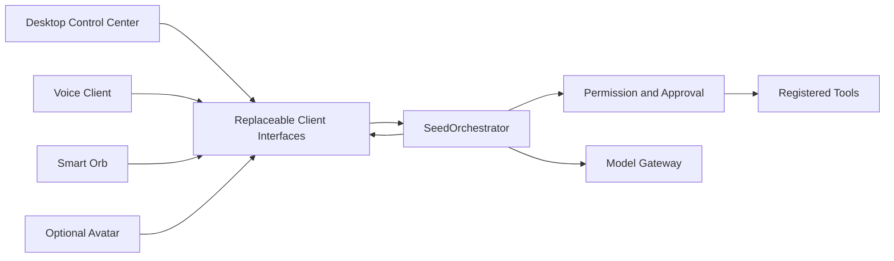

# SEED-AI Architecture

## Runtime Boundaries

SEED owns task/session state, model selection, tool registration, permission checks, execution limits, approval handling, and audit events. Providers and tool transports are adapters. A model response is never executed directly: tool calls must resolve through `ToolRegistry`, pass argument validation, and receive an `ALLOW` or consumed approval from `PermissionEngine` before a handler runs.

The main code paths are:

- `brain/model_gateway.py` routes typed requests to the registered provider adapters in `brain/providers/`.
- `core/orchestrator.py` coordinates model turns, context retrieval, bounded tool execution, approvals, retries, and task/session lifecycle.
- `core/application.py` is the shared composition root and `SeedApplication.seed_request()` is the request entrypoint for clients.
- `core/tool_registry.py` contains the closed set of executable tool contracts.
- `interfaces/tool_adapter.py` validates and authorizes requests arriving over MCP.
- `interfaces/desktop_server.py` serves the loopback-only Desktop Control Center and its SSE event feed.
- `interfaces/media.py` defines provider-neutral speech and visual/avatar contracts; it contains no active media runtime.
- `security/` contains permission, approval, and idempotency controls.
- `memory/store.py` owns SQLite access for tasks, events, sessions, memory, approvals, and idempotency records.
- `core/operations.py` and `core/service_registry.py` expose internal status and operational history APIs without a frontend dependency.

## Hybrid AI Companion Experience

**Approved direction; partially implemented.** SEED's visual identity combines an animated Smart Orb with an optional realistic 3D human avatar. Text, voice, and visual interactions are intended to share one SEED session and orchestration lifecycle. The local Desktop Control Center and event-driven Smart Orb are implemented; speech and avatar execution are not.



The desktop UI, voice engine, Smart Orb, and avatar are input/output clients only. They must not select tools, authorize actions, call providers directly, or make independent decisions. User objectives enter through a client interface backed by `SeedOrchestrator`; all tool execution, approvals, task/session state, and audit events remain owned by SEED. The MCP `seed_request` entrypoint is the current server-side shape for this boundary.

Keep client and media interfaces replaceable: a session/request client, speech-input adapter, speech-output adapter, visual-state client, and optional avatar renderer. Do not bind these interfaces to one STT, TTS, avatar, model, or audio provider. Transcribed Arabic or English text must enter the same orchestration path as typed text. Speech output is rendered from SEED's response; interruption cancels or supersedes playback and is communicated back to the same session.

The canonical presentation states are `idle`, `listening`, `processing`, `responding`, `executing`, `awaiting_approval`, and `error`. SEED emits or exposes these states from task, permission, and event lifecycle; the Orb and avatar only render them. Avatar lip movement follows output-audio timing/visemes, and facial expressions are presentation reactions to SEED state/response metadata, never an independent reasoning channel.

Microphone capture must have explicit privacy controls, an obvious visible listening indicator, and an explicit opt-in for the `Hey SEED` wake word. A user-visible mute/off state must prevent capture. Do not retain raw audio by default; any future retention requires an explicit policy and user-facing control. Voice interruption/barge-in must be supported without bypassing task cancellation or approval semantics.

The Desktop Control Center contains chat through `SeedApplication.seed_request`, task monitoring, provider/service status, approval requests, and audit history. It is a presentation client of the shared composition root; it does not call a model or tool directly. The Smart Orb reflects state derived from SEED's SSE event feed, whose payload omits event details and carries only normalized permission outcomes. The HTTP server is standard-library-only, bound to loopback, validates Host and same-origin/CSRF on POST, caps request size, limits concurrent event streams, and suppresses request/error logging. It does not provide user authentication: it is intended only for a trusted local development session and must not be exposed beyond localhost. Requests are synchronous; response-token streaming is not implemented.

Run the development interface with `D:\SEED-AI\.venv\Scripts\python.exe -B -m interfaces.desktop_server --port 8765`. For an isolated preview, set `SEED_DATABASE_PATH` and `SEED_WORKSPACE_PATH` in the server process to temporary locations before launch. Without those overrides the legacy project database/workspace defaults are used. The preview has no user login; use it only on a trusted local desktop.

### Hybrid Experience Status

- Implemented and locally verified: central orchestrator, shared `SeedApplication.seed_request`, MCP entrypoint, persistence/governance APIs, responsive desktop control center, Smart Orb state rendering, sanitized SSE event feed, task/activity/settings views, and same-origin/CSRF-protected requests.
- Contracts only: Arabic/English speech data types and replaceable STT/TTS/visual/avatar adapter interfaces. No audio capture, speech recognition/synthesis, wake-word runtime, barge-in transport, avatar renderer, or lip-sync engine is active.
- Not implemented: real VS Code chat acceptance against the Desktop HTTP service, model-token streaming, cross-device sessions, and authenticated multi-user access.
- No STT, TTS, wake-word, avatar, or visual-rendering provider has been selected.
- `workspace_list` is still separately exposed as a low-level MCP tool. It is permission checked, but clients must use `seed_request` for user objectives to preserve the central orchestration lifecycle; a future client policy should prevent low-level tools from becoming an alternate request path.

## Model Gateway

`ModelGateway.with_local_defaults()` registers Ollama (`http://127.0.0.1:11434`) with `qwen3:4b` as the offline-first default and keeps OmniRoute (`http://127.0.0.1:20128/v1`) as an optional provider. Override local routing with factory arguments or `OLLAMA_BASE_URL`/`OLLAMA_MODEL`; select OmniRoute explicitly with `SEED_MODEL_PROVIDER=omniroute`, and configure its URL with `OMNIROUTE_BASE_URL`. `ask_seedo()` remains explicitly routed to Ollama.

OmniRoute reads `OMNIROUTE_API_KEY` from the SEED server process environment or receives an injected credential callback. Credentials must not be written to source, logs, task messages, VS Code configuration, or frontend code. Capability metadata is queried from the selected provider; tool-bearing requests fail closed unless tool calling is explicitly advertised as supported.

Provider health checks make network requests. Use `OperationsAPI.status()` for cached/non-probing state and call `OperationsAPI.provider_health(refresh=True)` only when an active health check is intended.

## Orchestrator Wiring

Construct the runtime with injected dependencies; do not make a provider or editor own the task lifecycle:

```python
from brain.model_gateway import ModelGateway
from core.orchestrator import SeedOrchestrator
from core.task_engine import TaskEngine
from core.tool_registry import ToolRegistry
from security.permission_engine import PermissionEngine

orchestrator = SeedOrchestrator(
    gateway=ModelGateway.with_local_defaults(),
    tools=ToolRegistry(),
    permissions=PermissionEngine(),
    tasks=TaskEngine(),
)
result = orchestrator.run("Describe the task")
```

Register explicit `ToolDefinition` instances before running work. Use strict object schemas with `additionalProperties: false`. Mark a tool `parallel_safe=True` only for independent read operations. Retries are disabled unless the tool is marked `retry_safe=True`. The default execution identity is local and is not an authentication system; production callers must supply a trusted identity.

## MCP

The MCP server exposes `seed_request` for centrally orchestrated user objectives and retains `workspace_list` as a low-level SEED tool. VS Code is configured in `.vscode/mcp.json` to launch this local server with the workspace `.venv` interpreter; no provider endpoint or credential is configured in VS Code. The server and adapter route tool work through SEED's registry and permission layer.

The selected workspace interpreter has MCP SDK `2.3.0` on Python `3.14.4`; the official SDK requires Python `3.11+`. Actual stdio startup, tool discovery, a central request with an authorized tool, and a denied-policy request were exercised using temporary databases/workspaces and a fake model gateway. The default terminal Python is `3.7.7` and does not have MCP, so use `.venv` for the server.

The shared registry includes bounded workspace listing and read-only `system.health` metrics. VS Code, GitHub, Unreal Engine, Blender, Windows application/process control, and external API integrations are not implemented or registered. `system.health` reads host memory, logical processor count, disk usage, and SEED process metrics through `SeedApplication` and the standard permission/orchestration path; it does not invoke a shell.

## Persistence and Operations

`TaskEngine` initializes the SQLite schema. New tables are additive (`CREATE TABLE IF NOT EXISTS`); the existing `tasks`, `events`, and `memory` tables remain. Tests use temporary databases. The legacy production database path remains the default; `SEED_DATABASE_PATH` can select an isolated database. `SEED_WORKSPACE_PATH` can select an isolated workspace while preserving the original default.

Use `OperationsAPI` for active tasks, execution history, audit events, failure records, service registration state, provider health, and system resource snapshots. `system.health` is registered as a read-only SEED tool with the `system` scope. Windows system memory uses `GlobalMemoryStatusEx`; CPU count, disk capacity, process CPU time, and timestamped platform metadata are also returned. On Windows, process peak memory remains unavailable from the standard-library `resource` module.

## Verification Status

The isolated suite is `D:\SEED-AI\.venv\Scripts\python.exe -B -m unittest discover -s tests -v`. It uses temporary SQLite databases/workspaces and fake provider transports. The latest run passed 65 tests. Ollama/Qwen3 is configured as the default but `/api/tags` returned a connection error, so offline inference is not live-verified. OmniRoute is opt-in; its `/v1/models` returned HTTP 401 because `OMNIROUTE_API_KEY` is unavailable. No chat request was sent; live tool calling and model-backed orchestration remain blocked.

The VS Code MCP configuration was parsed and its interpreter path resolved to the existing `.venv`; an actual VS Code chat session was not launched. The MCP SDK is already installed in that environment, so no dependency installation or manifest change was made.