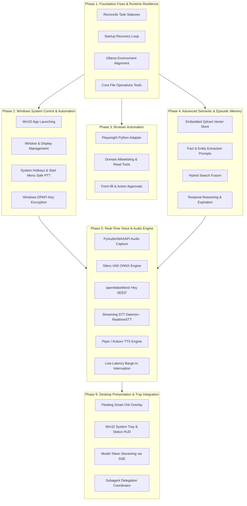

# SEED-AI Completion & Engineering Roadmap

**Document Purpose:** Phased engineering plan to complete SEED-AI into a production-grade, local-first personal AI operating assistant for Windows.
**Core Directive:** SEED remains the central intelligence, orchestrator, permission authority, memory owner, and execution coordinator. External capabilities are integrated as subordinate adapters.

---

## 1. System Requirements & Hardware Profiles

SEED-AI is engineered to operate on Windows 10/11 without requiring mandatory cloud connections or high-end server GPUs.

| Profile | Target Hardware Specifications | Local Model Stack | Target Response Latency |
|---|---|---|---|
| **Profile A: Low-Resource CPU** (Base Target) | • CPU: 4–8 cores (Intel 8th+ Gen / AMD Ryzen 2000+) • RAM: 16 GB DDR4/DDR5 • GPU: None or Integrated Intel/AMD • Disk: 20 GB free NVMe/SSD | • LLM: `qwen3:4b` / `qwen2.5:3b` via Ollama CPU • VAD: Silero VAD ONNX (<2 MB) • STT: `whisper-tiny.en` / `whisper-base` (int8) • TTS: Piper C++ / Kokoro-ONNX (int8) • Embeddings: `bge-small-en-v1.5` ONNX | • Wake Word: <100 ms • VAD Pause Detect: <50 ms • STT Final: <300 ms • LLM First Token: 1.5–3.0 s • TTS Synthesis: Realtime factor <0.3 |
| **Profile B: Accelerated Desktop** (Recommended) | • CPU: 8+ cores (Intel 12th+ Gen / Ryzen 5000+) • RAM: 32 GB DDR4/DDR5 • GPU: NVIDIA RTX 3060/4060+ (8–16 GB VRAM) • Disk: 50 GB free NVMe | • LLM: `qwen2.5:7b-instruct` / `qwen2.5-coder:7b` (VRAM) • Vision: `qwen2.5-vl:7b` or `llava:7b` • STT: `faster-whisper-small` / Parakeet (CUDA) • TTS: Piper high-quality / Kokoro-ONNX • Vector DB: Qdrant local embedded (HNSW index) | • Wake Word: <50 ms • STT Final: <150 ms • LLM First Token: <400 ms (CUDA) • Total Voice Turn-Around: <1.2 s |

---

## 2. Phased Implementation Plan

---

### Phase 1: Foundation Hardening & Runtime Resilience
**Focus:** Fix state drift in task lifecycle, add startup reconciliation, align Ollama daemon environment, and provide core safe filesystem tools.

#### Architectural Deliverables
1. **Task Engine Reconciliation Loop (`core/task_engine.py`):**
   - Implement `reconcile_startup_tasks()`: On application launch, query all tasks with `status IN ('pending', 'running')`. Reconcile orphaned tasks by checking associated events; if no recent heartbeat exists, mark them as `interrupted` with details logged in `events`.
   - Update `runtime/agent_runtime.py` to ensure `tasks.set_status(task_id, "completed")` is executed upon successful tool completion.
2. **Ollama Service Configuration Alignment:**
   - Document and script restarting the Ollama service with `OLLAMA_MODELS=D:\AI\Models` so the pre-downloaded 2.5 GB `qwen3:4b` model is active.
   - Run `tests/test_live_ollama_integration.py` to verify full 70/70 test pass rate.
3. **Core Governed Filesystem Tools (`runtime/file_tools.py`):**
   - Register atomic tools in `ToolRegistry` with strict schemas:
     - `file.read`: Read-only, `scope="workspace"`, `parallel_safe=True`.
     - `file.write`: Destructive action (`action="write"`), requires human approval (`PermissionEngine` -> `REQUIRE_APPROVAL`).
     - `file.search`: Read-only workspace grep/glob.
   - All paths strictly guarded by `WorkspaceGuard.validate_path()`.

#### Acceptance Tests & Criteria
- **Unit Test:** `test_reconcile_startup_tasks_marks_orphaned_tasks_interrupted()` verifies that tasks left in `running` across restarts are gracefully reconciled.
- **Unit Test:** `test_file_read_and_write_enforce_workspace_and_approval()` verifies that writing outside the workspace throws `PermissionError` and writing inside triggers an approval request.
- **Live Integration:** `LiveOllamaIntegrationTests` all 4 previously skipped tests pass against local `qwen3:4b`.

---

### Phase 2: Windows System Control & Host Automation
**Focus:** Implement secure desktop control, application launching via Start Menu, window management, and Windows DPAPI credential encryption.

#### Architectural Deliverables
1. **Windows Application Launcher (`runtime/windows_control.py`):**
   - Adapt Jarvis's `shell:AppsFolder` enumeration to discover installed Windows desktop and Store apps into a cached catalog (`%LOCALAPPDATA%\SEED-AI\apps_catalog.json`).
   - Register tool `windows.launch_app(app_name)`: validates against an allowlist; unknown apps require explicit user approval.
2. **Win32 Window & System Management:**
   - Register tool `windows.get_active_window()`: read-only foreground title and process name.
   - Register tool `windows.set_volume(level)` and `windows.lock_workstation()`.
   - Implement global hotkeys (`Ctrl+Win` for Push-to-Talk) using native `ctypes.windll.user32.RegisterHotKey` to prevent keyboard hook conflicts.
3. **Windows DPAPI Credential Store (`security/credentials.py`):**
   - Provide `encrypt_secret(plaintext: str) -> str` and `decrypt_secret(ciphertext: str) -> str` using Windows `CryptProtectData` and `CryptUnprotectData`.
   - Store sensitive API keys (e.g., OmniRoute, Brave) encrypted at rest in `data/credentials.enc`.

#### Acceptance Tests & Criteria
- **Unit Test:** `test_windows_app_launcher_denies_unlisted_executables()` validates that arbitrary `.bat` or `.exe` paths cannot be executed.
- **Unit Test:** `test_dpapi_encryption_roundtrip()` confirms secrets encrypt and decrypt accurately on Windows and fail on mismatched user identities.
- **Integration Test:** `windows.launch_app` successfully launches `notepad.exe` under human approval and captures process ID.

---

### Phase 3: Browser Automation via Governed Playwright
**Focus:** Integrate Microsoft Playwright Python as a subordinate tool provider for web browsing, search, and document extraction.

#### Architectural Deliverables
1. **Playwright Tool Adapter (`runtime/browser_adapter.py`):**
   - Initialize headless Chromium instance on demand with bounded memory limits.
   - Register SEED tools:
     - `browser.navigate(url)`: Read action, validates URL against blocked internal ranges (blocks `127.0.0.1`, `localhost`, `169.254.169.254` to prevent SSRF).
     - `browser.extract_content()`: Read action, extracts sanitized markdown and readable text.
     - `browser.click(selector)` and `browser.fill_form(selector, value)`: Write actions, **require human approval** before execution.
     - `browser.screenshot()`: Read action, returns image buffer for vision models.
2. **SSRF & Sandbox Guard:**
   - Enforce that `browser.*` tools cannot navigate to SEED's local desktop control port (`8765`), Ollama port (`11434`), or internal network routers without explicit approval.

#### Acceptance Tests & Criteria
- **Unit Test:** `test_browser_navigate_blocks_loopback_and_metadata_addresses()` proves SSRF protection.
- **Integration Test:** Browser tool navigates to an approved public URL, extracts text, and returns cleanly to `SeedOrchestrator`.
- **Governance Test:** `browser.fill_form` triggers `ApprovalManager.request()` and halts until the user approves.

---

### Phase 4: Persistent Semantic & Episodic Memory (Qdrant + Mem0 Patterns)
**Focus:** Supplement SQLite with embedded Qdrant vector storage and Mem0 fact extraction algorithms for cross-session recall.

#### Architectural Deliverables
1. **Embedded Qdrant Vector Integration (`memory/vector_store.py`):**
   - Initialize `QdrantClient(path="D:/SEED-AI/data/qdrant")` in local embedded mode (no separate service required).
   - Create collections: `episodic_memory` and `knowledge_facts`.
2. **Fact & Entity Extraction Pipeline (`memory/extractor.py`):**
   - Adapt Mem0's single-pass ADD-only extraction prompt: On conversation turn completion, extract salient entities and user preferences via the local Ollama model.
   - Route any extracted `user_preference` into SEED's existing `memory_items` table with `approved = 0` until human-approved.
3. **Hybrid Search Fusion:**
   - In `SeedOrchestrator.run()`, combine SQLite lexical search (`memory/store.py:search_memory`) with Qdrant vector similarity ($Score = 0.5 \cdot Dense + 0.5 \cdot Sparse$).
   - Retrieve top 5 memories and format as untrusted system context.

#### Acceptance Tests & Criteria
- **Unit Test:** `test_qdrant_embedded_persistence()` verifies vector storage and retrieval across engine restarts without Docker.
- **Unit Test:** `test_memory_extraction_flags_preferences_for_approval()` confirms extracted user preferences are gated before persistence.
- **Integration Test:** Ask SEED "Remember that my favourite programming language is Python", verify fact extraction, approve the preference, ask "What is my favourite language?", and verify memory recall.

---

### Phase 5: Real-Time Local Voice Engine (Arabic & English)
**Focus:** Microphone capture, Silero VAD, "Hey SEED" wake-word, streaming STT daemon, Piper/Kokoro TTS, and instant barge-in interruption.

#### Architectural Deliverables
1. **Audio Input Pipeline & VAD (`interfaces/voice_input.py`):**
   - Capture 16 kHz 16-bit mono PCM from Windows default recording device.
   - Run Silero VAD ONNX model on CPU every 32 ms chunk (<1 ms compute time).
   - Implement `openWakeWord` detector configured for "Hey SEED" (enabled only when user explicitly toggles privacy setting).
2. **Subordinate STT Daemon Interface:**
   - Connect `SpeechInputAdapter` to the local RealtimeSTT FastAPI WebSocket daemon (`127.0.0.1:8010`).
   - Feed streaming audio chunks; receive partial transcripts and final transcripts.
   - Support Arabic and English (`whisper-small` / Parakeet multilingual).
3. **Subordinate TTS Synthesis & Interruption (`interfaces/voice_output.py`):**
   - Connect `SpeechOutputAdapter` to precompiled `piper.exe` (`en_GB-alan-medium`, `ar_JO-kareem-medium`) or `kokoro-onnx`.
   - Pipe generated audio to Windows `sounddevice` or `waveOut`.
   - **Barge-in Logic:** When Silero VAD detects user speech while TTS is playing, immediately terminate playback audio buffer, invoke `SpeechOutputAdapter.interrupt()`, and transition SEED state to `listening`.

#### Acceptance Tests & Criteria
- **Contract Test:** All contracts in `interfaces/media.py` pass with concrete voice adapter instances.
- **VAD Latency Test:** Speech silence detection triggers endpointing within 400–800 ms of user pause.
- **Barge-In Test:** While TTS playback is simulated, feeding 100 ms of vocalized audio triggers instant audio playback stop within 60 ms.
- **Language Verification:** Verify accurate transcription and intelligible TTS output for both English ("List files in workspace") and Modern Standard Arabic ("ما هي حالة النظام").

---

### Phase 6: Desktop Presentation, Smart Orb & Multi-Agent Delegation
**Focus:** Floating desktop overlay widget, system tray, token streaming, and bounded subagent delegation under SEED supervision.

#### Architectural Deliverables
1. **Desktop UI Enhancement (`desktop/` & Native Tray):**
   - Add minimal PySide6 / Win32 system tray icon (`SEED-AI`) with quick menu: Mute, Standby, Dashboard, Exit.
   - Support floating Smart Orb always-on-top window that renders canonical SEED states (`idle`, `listening`, `processing`, `responding`, `executing`, `awaiting_approval`, `error`).
2. **Model Token Streaming via SSE (`interfaces/desktop_server.py`):**
   - Enable token streaming over `/api/events` using chunked transfer, allowing the desktop feed to display model responses in real time.
3. **Supervised Multi-Agent Delegation (`core/subagent.py`):**
   - Allow `SeedOrchestrator` to spawn scoped sub-sessions (e.g. Researcher, Code Reviewer) with explicit sub-budgets (max 4 steps).
   - Subagents share the central `PermissionEngine` and `ToolRegistry`; they have no independent execution rights.

#### Acceptance Tests & Criteria
- **UI Test:** Desktop control center renders live streaming tokens without blocking the main event thread.
- **Tray Test:** Clicking system tray "Mute" halts microphone capture and updates the Smart Orb state to `idle (muted)`.
- **Subagent Test:** Orchestrator delegates a subtask; subagent tool calls are audited under parent task ID and respect identical permission boundaries.

---

## 3. Engineering Acceptance Criteria Matrix

| Phase | Core Deliverable | Acceptance Criteria | Target Milestone |
|---|---|---|---|
| **Phase 1** | Task Engine Fixes & Ollama Sync | 100% tests passing (70/70), orphaned task recovery verified, file tools active. | Month 1, Week 1–2 |
| **Phase 2** | Windows Control & DPAPI | Start menu apps launchable under approval, DPAPI encrypts API keys, global hotkeys active. | Month 1, Week 3–4 |
| **Phase 3** | Playwright Browser Automation | Browser tools navigate allowlisted sites, SSRF blocked, write actions require approval. | Month 2, Week 1–2 |
| **Phase 4** | Qdrant Semantic Memory | Embedded vector search operational, user preferences require approval before storage. | Month 2, Week 3–4 |
| **Phase 5** | Real-Time Voice Engine | "Hey SEED" wake word, Arabic/English STT & TTS, barge-in stops speech in <100 ms. | Month 3, Week 1–3 |
| **Phase 6** | Desktop Orb & Subagents | Floating orb widget, tray minimization, token streaming, supervised subagents. | Month 3, Week 4+ |
