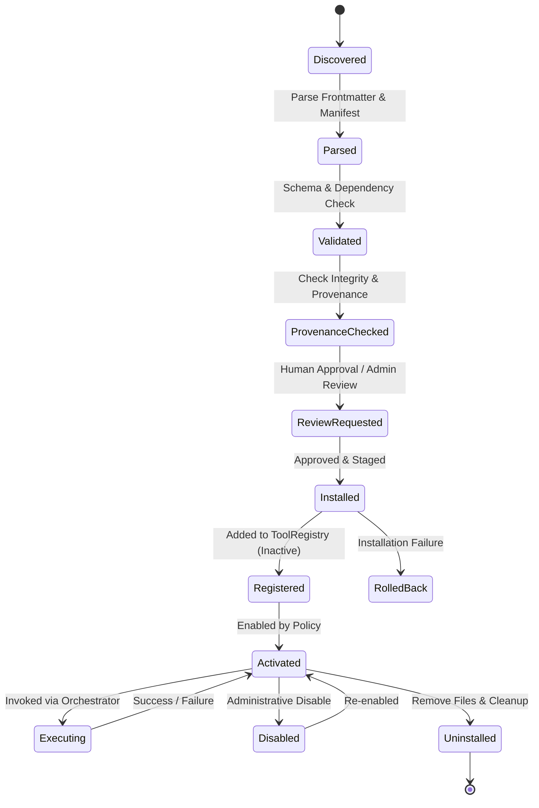

# 22-Phase 3 Engineering Design: Dynamic Skills, Tools, and MCP Engine (Updated with User-Approved Policies)

**Document ID:** `22-phase3-engineering-design`
**Project Root:** `D:\SEED-AI`
**Date:** 2026-11-12
**Status:** DESIGN ONLY — Updated with user-approved MANUAL skill trust and EXPLICIT MCP trust policies.

---

## Executive Summary
This engineering design specifies the complete architecture for **Phase 3: Dynamic Skills, Tools, and MCP Engine** in SEED-AI, fully incorporating the user-approved **MANUAL Third-Party Skill Trust Policy** and **EXPLICIT MCP Server Trust Policy**. SEED remains the sole central authority for orchestration, tool execution, permissions, approvals, and audit logging.

---

## 1. User-Approved Trust Policies
- **Third-Party Skill Trust (MANUAL):** Requires administrative review, provenance inspection, and cryptographic digest (`sha256`) binding. Skills cannot grant themselves permissions; approval is strictly bound to the exact artifact version and digest.
- **MCP Server Trust (EXPLICIT):** Discovered MCP servers remain inactive until explicitly configured in `mcp_servers.json` and approved by an administrator.

---
*(See `23-phase3-final-implementation-plan.md` for complete implementation milestones and approval contracts).*


---

## 1. Inspection of Existing Architecture
- **Tool Registry (`core/tool_registry.py`):** Holds strict schema-validated `ToolDefinition` instances with `additionalProperties: False`.
- **Permission Engine (`security/permission_engine.py`):** Enforces default-deny policies, granular scoping (`workspace`, `system`, `network`), and destructive action classification.
- **Approval Manager (`security/approval_manager.py`):** Binds approvals to cryptographic argument and identity digests with TTL expiration and replay protection.
- **MCP Adapter (`interfaces/tool_adapter.py`, `interfaces/seed_mcp_server.py`):** Exposes MCP tools using the official `mcp==2.3.0` SDK, validating arguments and writing task/audit events through SQLite.
- **Workspace Guard (`runtime/workspace_guard.py`):** Protects filesystem boundaries from traversal and symlink escapes.

---

## 2. Skill Lifecycle State Machine



- **Exact States:** `Discovered`, `Parsed`, `Validated`, `ProvenanceChecked`, `ReviewRequested`, `Installed`, `Registered`, `Activated`, `Executing`, `Disabled`, `Uninstalled`, `RolledBack`.
- **Failure Handling:** Any validation or installation error immediately transitions the skill to `RolledBack`, purging temporary files and unregistered state.

---

## 3. Skill and Tool Manifest Schemas (`SKILL.md` + JSON/YAML)

### A. Skill Manifest (`SKILL.md` Frontmatter Schema)
```yaml
name: "github-integration"
version: "1.2.0"
description: "Governed GitHub repository search and PR summary skill."
author: "SEED Team"
license: "MIT"
provenance:
  sha256: "e3b0c44298fc1c149afbf4c8996fb92427ae41e4649b934ca495991b7852b855"
permissions:
  - action: "read"
    scope: "network"
    target: "api.github.com"
tools:
  - name: "github.search_issues"
    description: "Search GitHub issues using query syntax."
    handler: "handlers.github_search"
    parameters:
      type: "object"
      properties:
        query: {"type": "string"}
      required: ["query"]
      additionalProperties: false
    action: "read"
    scope: "network"
    parallel_safe: true
```
- **Security Rule:** A skill manifest **cannot** grant itself permissions. All requested permissions are declared as proposals and must be independently evaluated and approved by `PermissionEngine` and human administrators.

---

## 4. MCP Integration Architecture
- **SDK & Transports:** Uses official `mcp==2.3.0` SDK supporting `stdio` subprocess transport and HTTP/SSE streams.
- **Discovery & Lifecycle:** External MCP servers are registered via secure configuration (`data/mcp_servers.json`). Upon startup, `MCPToolAdapter` discovers server tool definitions, validates their parameter schemas against SEED's strict rules, and registers them into `ToolRegistry`.
- **Isolation & Fault Containment:** MCP servers run as isolated child processes over `stdio`. If an MCP server crashes, hangs beyond timeout limits, or emits invalid payloads, the adapter catches the exception, terminates the process handle, logs an audit event, and fails closed without crashing the main SEED application.

---

## 5. Security Architecture & Threat Model
- **Prompt Injection Defense:** Model outputs and external SKILL.md instructions are treated as untrusted data. They can never invoke handlers directly or alter permission policies.
- **Provenance vs. Behavioral Security:** Cryptographic checksums verify *who* built the package and that bits did not flip in transit; they do *not* prove the code is safe. Behavioral safety is enforced by SEED's central runtime monitoring, default-deny permissions, and argument-digested approvals.
- **Path Traversal & SSRF:** All skill file operations pass through `WorkspaceGuard`; network calls pass through domain allowlists.

---

## 6. Execution Architecture
All skill and MCP tool calls execute through the unbypassed central pipeline:
`SeedApplication.seed_request()` → `SeedOrchestrator` → `TaskEngine` → `ToolRegistry` → `PermissionEngine` → `ApprovalManager` → `IdempotencyGuard` → Tool Handler Execution → SQLite Audit Log (`events`).

---

## 7. Python 3.14.4 Compatibility
- **In-Process Execution:** Standard Python skills and lightweight MCP stdio adapters execute directly within the main SEED process asynchronously.
- **Isolated Workers:** Heavy ML, embedding, or untrusted external code runs in isolated helper worker processes using compatible Python runtimes (e.g., Python 3.11/3.12) communicating via secure JSON-RPC over loopback pipes.

---

## 8. File-by-File Implementation Manifest (Phase 3)

| File Path | Status | Responsibility | Dependencies | Security Requirements | Tests Required |
|---|---|---|---|---|---|
| `runtime/skills/parser.py` | Create | Parse `SKILL.md` frontmatter & validate manifests | `pyyaml`, `jsonschema` | Strict schema checks, size limits | `test_skill_parser.py` |
| `runtime/skills/installer.py` | Create | Staging, provenance check, installation lifecycle | `shutil`, `hashlib` | Prevent path traversal in archives | `test_skill_installer.py` |
| `runtime/mcp/client.py` | Create | Manage MCP server connection lifecycle & stdio transport | `mcp`, `asyncio` | Process isolation, timeout guard | `test_mcp_client.py` |
| `core/application.py` | Extend | Register dynamic skill/MCP loader in composition root | `runtime/skills`, `runtime/mcp` | Central governance wiring | `test_phase3_integration.py` |

---

## 9. Test Catalog (Phase 3 Acceptance Tests)
- `test_skill_manifest_validation_rejects_malformed_yaml()`
- `test_skill_cannot_escalate_permissions_without_admin_approval()`
- `test_mcp_server_timeout_and_failure_containment()`
- `test_skill_installation_and_uninstallation_lifecycle()`
- `test_central_orchestrator_governs_dynamic_skills()`

---

## 10. Open Decisions Requiring User Approval
1. **Third-Party Skill Provenance:** Should third-party skills require cryptographic signature verification against a trusted CA root, or manual administrative review upon installation?
2. **MCP Server Trust Policy:** Should MCP servers auto-discover on startup or require explicit user configuration and approval in `mcp_servers.json`?

---
*Verified Implementation Evidence: Inspected `core/application.py`, `core/tool_registry.py`, `security/permission_engine.py`, `interfaces/tool_adapter.py`, and `interfaces/seed_mcp_server.py`. No production files were modified.*
