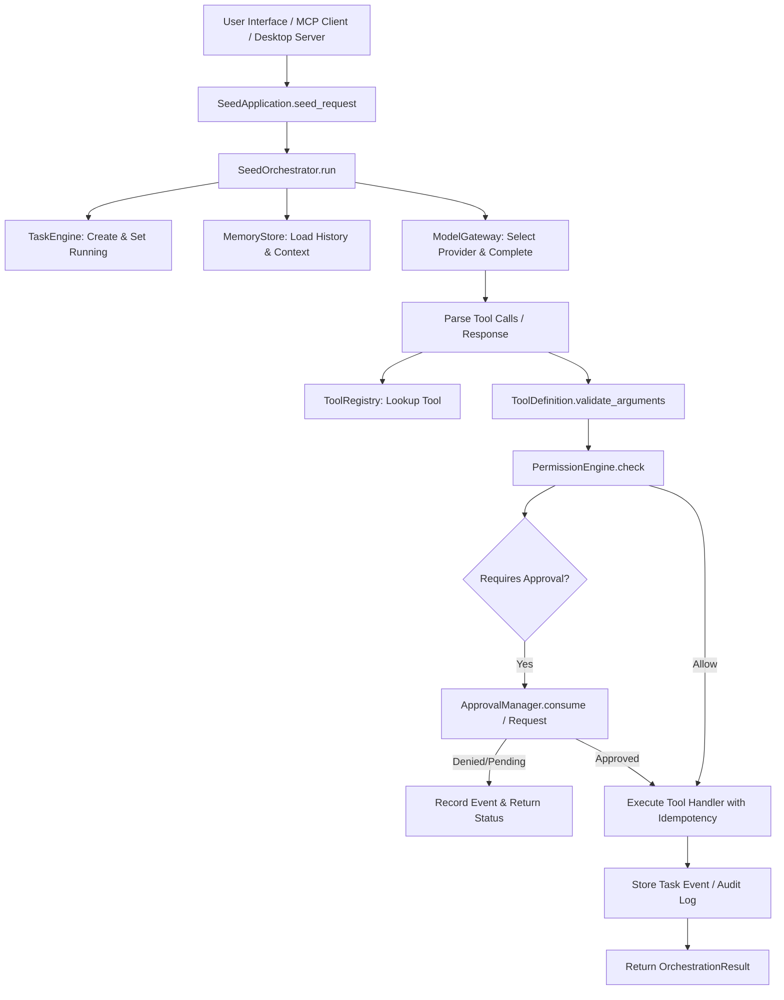

# SEED-AI Integration Map (Phase 1.5)

**Document Purpose:** Traceable mapping of the central execution path through SEED-AI components.

---

## Central Execution Trace: `SeedApplication.seed_request()`

## Component Status Breakdown

| Transition / Component | Implementation Status | Test Coverage | Verification Method |
|---|---|---|---|
| **User Interface / MCP Adapter** | Fully Implemented | Covered | Unit tests & fake transports |
| **`SeedApplication.seed_request()`** | Fully Implemented | Covered | Integration tests |
| **`SeedOrchestrator` Loop** | Fully Implemented | Covered | Unit tests (`test_orchestrator.py`) |
| **Memory Store & Session History** | Fully Implemented | Covered | Unit tests (`test_memory_store.py`) |
| **Model Gateway (`ModelGateway`)** | Fully Implemented | Covered | Unit tests (`test_model_gateway.py`) |
| **Tool Registry & Schema Validation** | Fully Implemented | Covered | Unit tests (`test_foundation.py`) |
| **Permission Engine (`PermissionEngine`)** | Fully Implemented | Covered | Unit tests (`test_governance.py`) |
| **Approval Manager (`ApprovalManager`)** | Fully Implemented | Covered | Unit tests (`test_governance.py`) |
| **Tool Execution & Idempotency** | Fully Implemented | Covered | Unit tests (`test_governance.py`) |
| **Audit Persistence (`events` table)** | Fully Implemented | Covered | Unit tests (`test_foundation.py`) |
| **Live Model Inference & Tool Calling** | Implemented in Code | BLOCKED | Awaiting Ollama environment alignment (`OLLAMA_MODELS`) |
